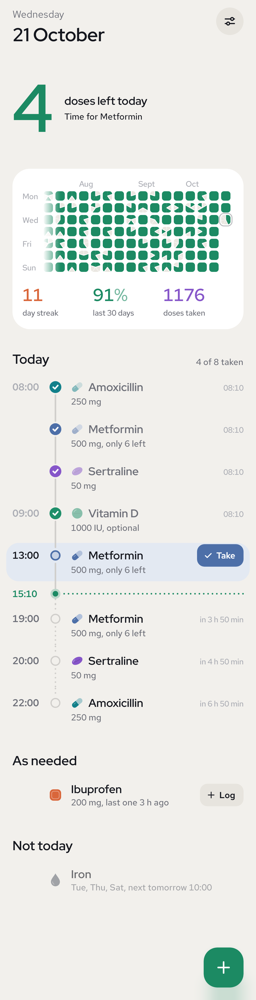
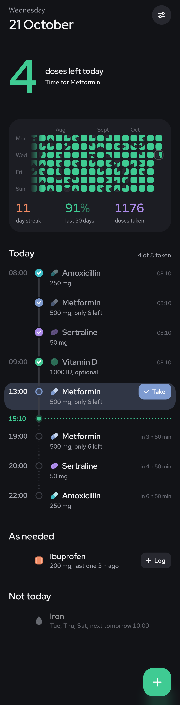
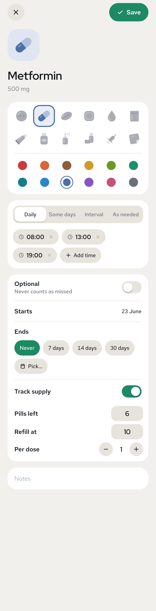

# p1ll

Pill tracker for Android. A year chart shows one square per day, split into one slice per dose.

<p>
  
  
  
</p>

## Features

- Schedules for every day, chosen weekdays, every N days, or as needed
- Pills, powders, creams, liquids, sprays, inhalers, injections and patches, in 12 colours
- One reminder per dose that stays until you act on it: Take opens the app and ticks the dose off, Snooze turns it into a one-line silent notification that won't alert again
- Optional repeats until a dose is taken or snoozed
- End dates, with history kept
- Optional pills, never counted as missed
- Supply count with a refill warning
- Swipe right to take, left to skip, including doses already ticked
- Page back through earlier days with the arrows, a sideways swipe on the header, or a tap on the chart; tap a dose there to edit that day
- Backdate a pill and mark its past doses taken

## Build

```sh
./gradlew testDebugUnitTest assembleRelease   # signed APK in app/build/outputs/apk/release/
./gradlew recordRoborazziDebug                # re-render docs/screenshots
python3 tools/sounds.py                       # re-synthesise the sounds in res/raw
python3 tools/fonts.py <RedHatDisplay[wght].ttf> <RedHatText[wght].ttf>   # re-cut the static font weights
```

Requires JDK 17+ and the Android SDK (compileSdk 36).

## Releases and signing

Push a tag and CI attaches a signed APK to its GitHub release:

```sh
git tag v0.1.0 && git push origin v0.1.0
```

`v1.2.3` builds version name `1.2.3`, version code `10203`. A suffixed tag such as `v1.2.3-beta.1` keeps that code and is published as a pre-release. CI's own APKs are version `0.1.0`, so they won't install over a release.

The release keystore and its passwords are committed in `keystore/`, so CI signs without secrets. Anyone with this repo can sign an APK that installs as an update to p1ll. Moving the key to GitHub Secrets means rotating it, after which existing installs must uninstall before updating.

Signing certificate SHA-256:

```
2C:EE:D7:33:AB:DF:7B:72:CA:8D:B2:82:C3:0B:66:3E:CF:C7:A5:15:00:28:0A:88:DF:E7:74:97:34:2A:F3:82
```

## Notes

- Reminders use `USE_EXACT_ALARM`, granted at install on Android 13+. Play allows it only for alarm and calendar apps, so a Play build would need `SCHEDULE_EXACT_ALARM`.
- One alarm drives all reminders, so doses due together aren't throttled under Doze and missed ones post after a reboot.
- On Pixel 9 and 10, Android 16's Notification organizer can file individual notifications as silent. If reminders arrive without sound, exclude p1ll under Settings › Notifications › Notification organizer.
- A snoozed reminder is minimized, on a channel of its own (Android won't quieten a channel the user has edited, so 1.1.x's was replaced). Stock Android shows it on one line under Silent. Samsung's One UI shows it on one line, and under More notifications only when Settings › Notifications › Advanced settings › Filter notifications › Minimized notifications is on.
- Fonts: [Red Hat Display and Red Hat Text](https://github.com/RedHatOfficial/RedHatFont), SIL Open Font License (`licenses/`).
